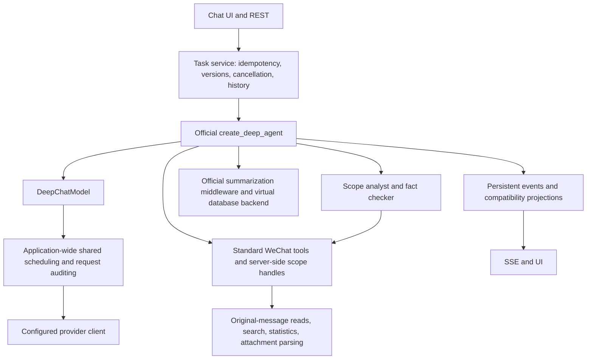

# WeChat Assistant DeepAgents v3

This document supersedes the previous three-stage execution flow. The dependency is pinned to `deepagents==0.7.13`, with transitive dependencies locked by `uv.lock`. Acceptance records are in the historical migration acceptance document, which is not distributed with the public source.

## Execution Path

`AgentService` retains the task lifecycle needed by the HTTP layer. Production execution inherits `DeepAgentRuntime` and no longer runs the old `parse_context → decision → answer` loop. The old report main loop and subtask executor are no longer in the production call chain. Reused pagination, date, original-message, statistics, and source functions remain independent data capabilities.

Greetings and capability questions produce the body directly in the same main-model request, without a model router or greeting allowlist. Initial tools provide only scope selection and internal-note writing. Lookup tools become available once internal material exists; existing notes can be edited directly without querying chats first. Query, statistics, and analysis tools become available after scope selection. The model may answer directly without a mandatory tool call.

Message submission only validates account ownership, reads local model configuration, persists the task, and starts execution. Conversation and person directories and indexes are used only when query tools actually execute. Model capabilities are read from the local cache; remote catalog refresh does not block submission. Complete conversation ID lists remain in server state; the model receives counts, a limited set of candidate names, and a scope handle.

## Module Responsibilities

| Module | Responsibility |
| --- | --- |
| `deep_runtime.py` | Official graph construction, public middleware, subgraph delegation, versioning and resumption, body projection, and final validation |
| `deep_model.py` | Native tool and JSON protocol adaptation; model request scheduling, metering, timeouts, and compatibility cache |
| `reasoning_client.py` | Passes extension fields through the official SDK, retaining `reasoning_content` required by MiMo native multi-turn tool messages |
| `deep_tools.py` | Query scopes, read cursors, committed pages, retrieval, exact statistics, and original-source lookup |
| `deep_backend.py` | Database virtual-file backend isolated by account, run, and input version |
| `deep_context.py` | Official summarization triggers, history persistence verification, and preservation on failure |
| `deep_validation.py` | Independent evidence validation for dates, file claims, source ownership, and complete reports |
| `deep_projection.py` / `deep_subtasks.py` | Compatibility projections for existing answers, sources, material pagination, and subtask fields |

## Data Scope and Integrity

- `account`, run ID, and input version are injected by the server. Tool arguments contain no field that can change the account.
- `scope_handle` binds to the current run and version; expired, cross-run, or cross-account handles cannot read material.
- Reads use a fixed cutoff time, fixed time zone, and half-open intervals. Explicit user times take precedence over model conversions. The latest N messages means the total explicitly requested by the user, not a page size.
- Queries match explicitly named conversations to prevent expansion to all chats after argument failure. Duplicate names return clarification candidates. A complete read cannot cover only a subset of the named subjects.
- Ordinary search saves actual hits and sources. Gaps in live data use a separate cursor for lookup; search completion is not analysis completion.
- Every page of a complete scope first saves original text, then commits findings with sources and coverage intervals. Submission is required even when there are no relevant findings. Failure replay returns the same uncommitted page.
- Sources are deduplicated by actual message identity. Messages within the same second use stable cursors and message identities; character offsets for long messages are saved with their pages. Coverage display merges by conversation so overlapping ranges do not double counts.
- Exact statistics are computed by the program; daily and speaker distributions paginate over computed results. A read with gaps or warnings cannot be claimed as complete.

Batch notes retain the sequence within the query scope in `batch_index`. Filenames are `/notes/batch_<index>_<page-identity>.json`; page identity is computed from task ID, input version, and page ID to prevent different scopes, subtasks, or inherited history from occupying the same file. Repeated subtask merges reuse this path, and merging and committing use the same storage lock. Subtask aggregates, relay results, and ordinary notes are stored in `/notes/subtasks/<subtask-version-identity>/` and do not count as original parent-task batches.

Batch aggregation, resumption, and page statistics reuse the same persistent read entry point, ordered by commit time, with continued read support for old numeric filenames and bare-dictionary records. Missing required fields, incorrect field types, or corrupted JSON raise `StageNoteCorruptedError`, containing only note, task, version, and faulty-field locations, without chat bodies. Resumption counts only the current version's `batch_*.json`, without recounting relay summaries; display of old `stage_note` records still validates their known format. This fix does not automatically reconstruct historically overwritten notes.

Aggregation first performs deterministic fact deduplication and retains only original-source mappings referenced by facts, then checks whether the aggregate exceeds the 48 KiB safe window. Full batch originals remain in their original files. Necessary relay requests also carry only referenced mappings. After relay facts pass body, source, and quotation validation, the result is saved as `relay_reduction` with a fingerprint of fact content, reference mappings, and the compaction prompt. Resumption and concurrent calls within the same task version reuse the result. Current message count, source coverage, and batch indices are recalculated rather than treating old statistics as a new scope. Corrupted caches raise explicit errors instead of hiding the problem with another model call. Aggregation is serialized within a task version and reads current batches after acquiring the lock, preventing stale results from overwriting newer ones. The aggregate batch count always represents original batches, not relay groups.

After the parent task's complete content scope and required branches finish, `/notes/aggregated.json` is refreshed once before the main model's next call. The server reads the complete virtual file, without the model file tool's 2000-line pagination limit. Full fact text enters the existing context metering and compaction flow as a material message; the system prompt contains only the path and statistics. The same semantic snapshot is not injected again while it remains in valid context. Changed or already archived snapshots append a new message so facts are not hidden at an old compacted position. The main model directly composes the final response according to the current user requirements and requested format, without a fixed four-chapter structure, an independent report-generation call, or a post-answer verification call. Ordinary Q&A, pure statistics, and subtasks retain the existing completion entry point; closing a parallel plan submits only the integrated conclusion and no longer repeats aggregation through a thread bridge.

Scope analysts and fact checkers execute through the official `task` subgraph entry point. The server binds the scope to the child run; scope analysts cannot narrow or expand assigned scopes or change a restricted speaker. Subtasks cannot delegate recursively. Scopes exceeding 60 days are split into 30-day slices. Completed subtasks are reused by deterministic identity, without recounting usage or original messages during parent aggregation.

## Models and Context

Native mode uses automatic tool selection and may stream the response body. Non-native mode accepts only a tool list or a final-answer JSON containing the complete body; the adapter converts it to a standard `AIMessage` before DeepAgents continues execution. The JSON body is shown after validation, without another body request. Compatibility mode is selected only when tool arguments are explicitly rejected, and its cache is isolated by endpoint, model, and configuration version. Endpoints confirmed to support JSON mode enable that format constraint while retaining local structure checks.

Argument corrections, compatibility retries, attachment parsing, summarization, subtasks, and evidence checks use the same scheduling and audit. Application-wide model concurrency is capped at four, with foreground requests prioritized and backoff on rate limits. Queue cancellation or local adapter-initialization failure is not counted as a sent model request; requests without returned upstream usage are explicitly recorded as unknown.

MiMo extension fields pass through the official OpenAI SDK intact, while thinking fields stay out of the displayed body. Confirmed provider output limits inform budgets; explicit model settings and thinking levels remain authoritative. See [MiMo multi-turn tool requirements](https://mimo.mi.com/docs/en-US/quick-start/usage-guide/text-generation/deep-thinking), [model length limits](https://mimo.mi.com/docs/en-US/quick-start/summary/model), and [JSON mode](https://mimo.mi.com/docs/en-US/quick-start/usage-guide/text-generation/structured-output).

Context is triggered by the official summarization middleware. `DurableSummarization` handles persistence verification, segmented summarization, and over-limit recovery. The default threshold is 80% of the available input budget, targeting retention of approximately 10% of recent messages; normal summary requests are limited to 55%. These budgets use conservative UTF-8 byte estimates and include tool definitions, tool arguments, and thinking fields that must be returned. They are not actual provider Token usage; main-request usage calibration does not change this summarization measurement.

All history awaiting compaction enters segmented summarization chronologically, replacing tail trimming that required a user-message starting point. A single oversized message is also split at Unicode character boundaries. Each segment's full request includes the prompt, cumulative summary, and message wrappers. The model merges the previous summary with the current segment to produce a new cumulative summary. The summary target limit is 20% of the current summary-request budget, up to 8192 UTF-8 bytes. Empty summaries, oversized summaries, and framework placeholders are attempted at most three times; failure preserves the original checkpoint. This is semantic summarization without guaranteed verbatim retention; complete originals remain accessible through archive paths.

If a local check or provider reports a context overflow below the threshold, the framework immediately compacts and retries. If the main request still overflows after proactive compaction, at most two additional recovery attempts halve recent-message retention and the summary-request budget each time (minimum summary-request budget: 1024). If a summary request itself overflows, its segment shrinks without advancing the cursor of the unsuccessful segment. If even fixed prompt content cannot fit, execution stops to avoid infinite retries. Completed tool batches exceeding both the recent-retention amount and summary-request budget may be archived and summarized as complete groups, preserving tool-call/result pairing. History archives are verified before the compacted main-model call; archive or summary failure does not commit compaction. The whole flow retains the same model scheduling and usage audit, and summary bodies do not enter the public answer.

The production `SawtoothSummarization` entry point retains no recent tail during emergency overflow and archives from the last complete tool-interaction boundary; unfinished tool calls and results remain together. It must not first subtract the final message while leaving the newly read large chat batch unchanged in an oversized request. Summary Markdown wrappers and path characters are validated separately. Failure records retain specific local validation explanations, available by expanding the failed frontend entry; logs retain only redacted error categories and stack locations. Ordinary summary-service exceptions still preserve the ability to continue the task.

The virtual-file backend does not connect to the host filesystem. The model can modify only `/notes/`, `/plans/`, and `/drafts/`; original messages and application instructions are read-only. Framework history and large results are stored in internal areas by the server. Instructions in material or subtasks cannot change these boundaries. No terminal, internet-search, or WeChat-send tools exist.

New turns within the same AI conversation bridge recent conversation, retrievable sources, and internal notes. Notes with citations first validate identifiers and ownership; notes are neither original evidence nor new user instructions. Other AI conversations do not inherit this material.

## Completion, Stopping, and Resumption

New tasks store `engine=deepagents` and `engine_version=3`. Checkpoints reside in the separate `deepagents_checkpoints.sqlite3`; new-run namespaces include account, AI conversation, run, and input version. v3 namespaces from early isolated acceptance retain compatible reads and are not mixed with old-engine checkpoints.

Stopping preserves original messages, pending pages, findings, and subtask results. Resumption uses the new checkpoints. If the graph has saved a final answer but the application has not committed completion, it delivers the saved body directly. Drafts saved by older versions still take priority on resumption and are not overwritten by earlier graph bodies. Requirements added during execution first increment the version and cancel old work, then continue under the new version; stale results cannot commit.

After body generation, the answer is saved and the task ends directly. Independent citation checks, evidence reviews, omission checks, and automatic corrections no longer run afterward, and no model calls are added for them. Ordinary Q&A, complete reports, and subtasks all use this completion flow.

Read scopes, page commits, and data-source gaps remain recorded using program states returned by tools. Stage results are retained while complete scopes remain unfinished. Post-answer checking is no longer a prerequisite for completion.

## Historical Migration and Interfaces

Before the first startup switches engines, the SQLite backup API writes `before-deepagents-v3.sqlite3`, then records a migration marker. Old answers, sources, usage, and original task states remain readable. Old unfinished tasks cannot continue from old checkpoints and do not automatically incur model costs.

Existing `/api/ai/agent` conversation, message, run, material, and SSE interfaces remain. Additions:

- Run fields: `engine`, `engine_version`, `can_resume`, `restart_required`, `restarted_from`.
- Coverage states: `not_applicable`, `partial`, `complete`, `unknown`.
- `POST /runs/{id}/restart`: body contains `request_id`; idempotently creates a new-engine run linked to the old run.
- Calling `continue` on an old-engine run returns an explicit migration error and an entry point to restart.

Deleting an AI conversation or purging an account also removes original material, internal files, subtask associations, and new checkpoints. Production execution has no automatic fallback to the old engine. To roll back the application version, first stop tasks, save another copy of the migrated database, then restore a backup matching the old version; new graph checkpoints cannot be given to old code.

## UI and Builds

The timeline comes from actual model, tool, and subtask events, without a predefined three-stage sequence. Only the main Agent's user-facing body enters the answer area; internal summaries and verification work are excluded. Conversations without data queries do not show conversation counts, index hints, coverage warnings, or empty source entries.

Execution uses the official `astream_events(version="v3")` stream, receiving normal reply bodies according to message identity and task ownership. It reads only `text-delta` and does not display reasoning or tool arguments. `progress_message` has been removed from tool definitions and execution paths. Public bodies returned alongside model tool calls are saved as stage reports, with the final answer containing no tool calls retained separately. JSON compatibility mode converts the protocol body back to standard `AIMessage.content` without adding business tool arguments.

Stage reports focus on completed work, existing findings, and remaining uncertainties. They can follow a group of operations without announcing each tool or next-step plan. Prompts define them as normal communication during long tasks: share findings after first obtaining useful material if analysis must continue, then report key findings, changed judgments, or obstacles affecting the result. No opening announcement is needed before material is obtained; simple or nearly complete tasks answer directly. There is no program rule forcing replies by elapsed time, message count, or turns, and missing stage text does not block execution or trigger a retry. Public reports are promptly saved and pushed as application `progress` timeline events, interleaved with operation records in actual order and displayed as ordinary paragraphs with Markdown and existing citations. The final body is separate and does not overwrite earlier reports. Only actual public model replies are shown; stage text is not invented and progress does not cause extra model calls.

Processes containing stage replies remain visible by default after completion, with a one-click collapse option. Explicit expansion/collapse choices survive progress refreshes and remounting. Completed history without stage replies retains its previous collapse behavior.

Official basis: [Deep Agents Streaming](https://docs.langchain.com/oss/python/deepagents/streaming) distinguishes model messages, step updates, and custom events; [Event streaming](https://docs.langchain.com/oss/python/deepagents/event-streaming) recommends v3 and explains that raw protocol events can be consumed when exact arrival order matters. This project uses v3 consistently for main tasks and subtasks with independent persistent checkpoints, writing events to the existing timeline under each task's identity. These interfaces transport already generated content; they do not automatically generate natural-language stage summaries.

SSE supports reconnection with persistent event IDs, record IDs, and revisions. Body deltas are projected directly; after body generation, the answer is saved and completion is published. Source navigation, person capsules, copy, scrolling, and model selection interactions are retained.

`.github/workflows/ai-cross-platform.yml` retains source checks for AI, retrieval, frontend, desktop notifications, and startup. Further installer and portable-archive releases are paused; packaging scripts and dedicated tests for frozen AI applications have been removed. Previous frozen-environment acceptance is historical and does not represent current release capability.

Official framework references: [Overview](https://docs.langchain.com/oss/python/deepagents/overview), [Backends](https://docs.langchain.com/oss/python/deepagents/backends), [Context](https://docs.langchain.com/oss/python/deepagents/context-engineering), and [Subagents](https://docs.langchain.com/oss/python/deepagents/subagents). Dependency package source has not been modified.
